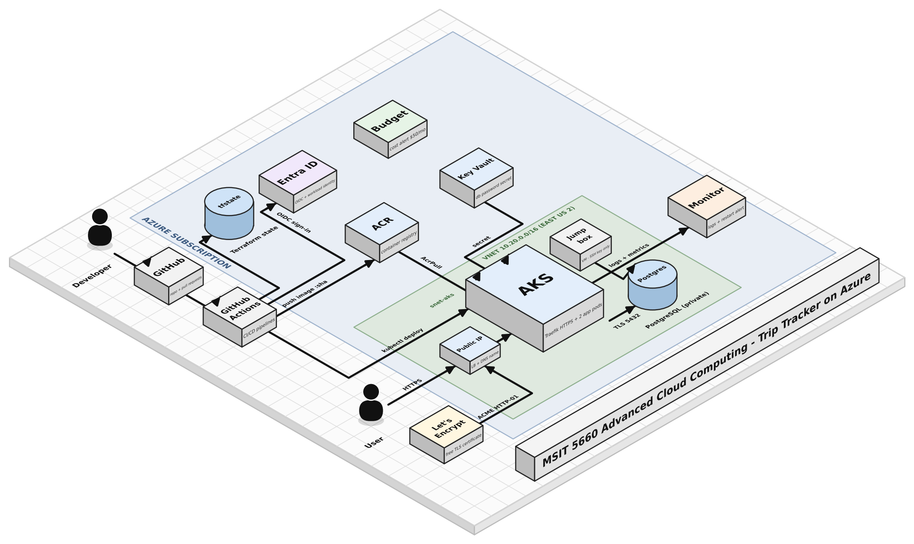

# Trip Tracker on Microsoft Azure

A small trip-planning web app, deployed on Microsoft Azure the way a cloud DevOps team would build it: **everything as code, every change through a pull request, and no stored secrets.**



> Built as my final project for MSIT 5660 – Advanced Cloud Computing (Fall 2026).

---

## Highlights

- **Infrastructure as Code:** 16 Azure services defined in **Terraform**, with remote state in Azure Storage (versioned and locked).
- **Kubernetes:** the app runs on **Azure Kubernetes Service (AKS)** with 2 replicas, readiness/liveness probes, and a restricted security context (non-root, read-only filesystem, all capabilities dropped).
- **HTTPS:** **Traefik** ingress + **cert-manager** with a free **Let's Encrypt** certificate that renews automatically. HTTP redirects to HTTPS.
- **Private data:** **Azure Database for PostgreSQL Flexible Server** with no public access, reachable only from the AKS and jump box subnets (network security groups).
- **No stored secrets anywhere:**
  - GitHub Actions signs in to Azure with **OpenID Connect (OIDC) federation**.
  - The app reads its database password from **Azure Key Vault** through **Entra ID workload identity** and the Secrets Store CSI driver.
  - AKS pulls images from **Azure Container Registry** with its managed identity.
- **CI/CD:** two GitHub Actions pipelines (below).
- **Monitoring:** Container Insights → Log Analytics (KQL), plus an alert that emails me if any app container restarts.

## How changes are delivered

| Pipeline | On pull request | On merge to `main` |
|---|---|---|
| [`terraform.yml`](.github/workflows/terraform.yml) | `fmt` check, `validate`, `plan`, plan posted as a PR comment | `plan` + `apply` |
| [`app.yml`](.github/workflows/app.yml) | Build the image and smoke-test it (imports, non-root user, version) | Push image tagged with the commit SHA to ACR → `kubectl set image` → wait for rollout → HTTPS smoke test |

Every running pod can be traced back to the commit and pipeline run that deployed it (`kubectl rollout history`).

## Azure services used

| Area | Services |
|---|---|
| Foundation | Resource Groups, Cost Management budget, Storage (Terraform state) |
| Networking | Virtual Network (3 subnets), Network Security Groups, Azure DNS (public label + private zone), Public IP + Standard Load Balancer |
| Compute | Azure Kubernetes Service, Azure Container Registry (+ ACR Tasks), Virtual Machine (jump box) |
| Data | Azure Database for PostgreSQL Flexible Server |
| Identity & security | Microsoft Entra ID (managed identities, workload identity, OIDC federation), Azure RBAC, Azure Key Vault |
| Monitoring | Azure Monitor, Log Analytics, Container Insights, alert rules + action group |

## Repository layout

```
infra/                  Terraform: network, NSGs, Key Vault, PostgreSQL, jump box, ACR, AKS,
                        monitoring, public IP, app identity, alerts
app/                    FastAPI app + Dockerfile (python:3.12-slim, non-root UID 10001)
k8s/                    Namespace, service account, ConfigMap, SecretProviderClass,
                        Deployment, Service, Ingress (HTTPS + redirect)
k8s/platform/           Traefik Helm values, Let's Encrypt ClusterIssuers
.github/workflows/      terraform.yml, app.yml
docs/                   Architecture diagram
```

## Things that broke (and what I learned)

- **Startup race condition:** two replicas created the database schema at the same time and one crashed (`UniqueViolation`). Fixed with a PostgreSQL advisory lock and shipped as v2 through the pipeline.
- **Role assignment propagation:** the cluster couldn't attach the static IP for ~27 minutes because a new Azure RBAC role hadn't propagated yet (eventual consistency).
- **OIDC subject mismatch:** GitHub's token subject included numeric owner/repo IDs, so the federated credential had to match that exact format (`AADSTS700213`).
- **Smoke test false alarm:** `curl --retry` doesn't retry "connection refused", so a healthy deploy was marked failed. Fixed with `--retry-all-errors`.
- **Region/SKU limits:** a VM size and PostgreSQL were unavailable in East US for my subscription, so the workload moved to East US 2.

**My rule by the end:** read the exact error, confirm the real state from a second source, then change something.

## Future improvements

- Manage Traefik and cert-manager with Terraform's Helm provider or GitOps (Flux / Argo CD)
- Separate least-privilege identities for plan, apply, and deploy; branch protection with required reviews
- Private AKS API server, dedicated database role for the app, HSTS headers, and a web application firewall
- Run database migrations as a Kubernetes Job; add a second node pool

## Tech stack

Azure · Terraform · Kubernetes (AKS) · Docker · GitHub Actions · FastAPI (Python) · PostgreSQL · Traefik · cert-manager · Let's Encrypt
